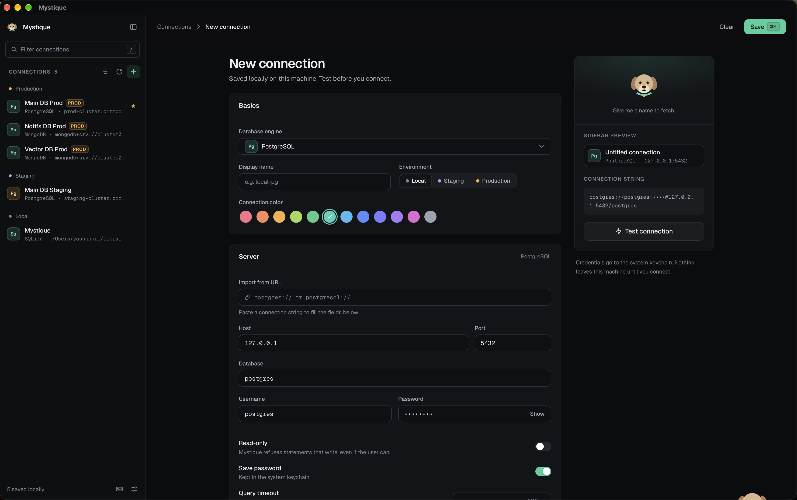

<p align="center">
  
</p>

<h1 align="center">Mystique</h1>

<p align="center">
  A calm, fast desktop client for PostgreSQL, MySQL, SQLite and MongoDB.<br />
</p>

<p align="center">
  <a href="https://github.com/yash1200/mystique/releases/latest"><b>Download</b></a> ·
  <a href="#features">Features</a> ·
  <a href="#supported-databases">Supported databases</a> ·
  <a href="#install">Install</a>
</p>



## Features

#### Connections

- Save connections with a name, colour and environment. Production connections are marked in amber wherever they appear.
- Connect over SSL or an SSH tunnel, or paste a connection URL to fill in the form.
- Keep several connections open at once and switch between them from the session rail.

#### Data grid

- Filter, sort and page through the rows of any table or collection.
- Edit cells inline; add, duplicate and delete rows with undo and redo. Review the exact SQL before you save.
- Copy cells, rows or a selection as CSV, TSV, JSON, Markdown, or as `INSERT`, `UPDATE` and `WHERE` statements.
- Import rows from CSV, JSON or JSON Lines. Export to the same formats or to SQL inserts.

#### Query editor

- Run the statement at the cursor or the whole script, and cancel a query that runs too long.
- Format queries, fill in parameters before a run, and read explain plans.
- History and saved queries for every connection.

#### Schema

- Columns, keys, indexes, foreign keys, triggers and constraints for any table, plus a schema compare.
- ER diagrams with auto-layout. Download one as a PNG or copy it as DBML.

#### Agent

- Ask the agent in a query tab to draft or fix a query against the open connection. Use your own Anthropic, OpenAI, Gemini or OpenRouter key, a local model through Ollama, or an agent you already have, such as Claude Code, Codex or Gemini CLI.
- Claude Code, Codex, Cursor and other MCP clients on your machine can use Mystique's database tools too. Each connection has an access level (read, write or full), and risky writes wait for your approval.

#### Everyday

- Live sessions and slow queries in server metrics.
- Quick open (⌘K / Ctrl+K) for connections, tables, saved queries and commands.
- Four themes, two dark (Night, Abyss) and two light (Day, Linen), or follow the system.

## Supported databases

| Database          | Query editor | Data grid | ER diagram | Server metrics |
| ----------------- | :----------: | :-------: | :--------: | :------------: |
| PostgreSQL        |      ✓       |     ✓     |     ✓      |       ✓        |
| CockroachDB       |      ✓       |     ✓     |     ✓      |       ✓        |
| MySQL             |      ✓       |     ✓     |     ✓      |       ✓        |
| MariaDB           |      ✓       |     ✓     |     ✓      |       ✓        |
| TiDB              |      ✓       |     ✓     |     ✓      |       ✓        |
| SQLite            |      ✓       |     ✓     |     ✓      |       ✓        |
| MongoDB           |      ✓       |     ✓     |     ✓      |       ✓        |
| Amazon DocumentDB |      ✓       |     ✓     |     ✓      |       ✓        |

## Install

Download the file for your system from the [latest release](https://github.com/yash1200/mystique/releases/latest).

| System  | Architectures        | File                            |
| ------- | -------------------- | ------------------------------- |
| macOS   | Apple silicon, Intel | `.dmg` (`aarch64` or `x64`)     |
| Windows | x64, ARM64           | `-setup.exe` (`x64` or `arm64`) |
| Linux   | x64, ARM64           | `.deb`, `.rpm` or `.AppImage`   |

Builds are not signed by Apple or Microsoft yet, so the first launch needs one extra step.

#### MacOS

Open the `.dmg` and drag Mystique to Applications. If macOS says it can't check the app, open **System Settings › Privacy & Security** and click **Open Anyway**.

#### Windows

Run the installer. If SmartScreen says "Windows protected your PC", click **More info › Run anyway**.

#### Linux

Download the `deb` or `rpm` or `AppImage` and run the following commands according to the file:

```bash
sudo apt install ./Mystique_*_amd64.deb      # Debian, Ubuntu
sudo dnf install ./Mystique-*.x86_64.rpm     # Fedora, RHEL
chmod +x Mystique_*.AppImage && ./Mystique_*.AppImage   # anywhere else
```

On ARM64 the files end in `arm64.deb`, `aarch64.rpm` and `aarch64.AppImage`.

## Run it locally

You need Node 22+, pnpm, Rust and the usual Tauri prerequisites for your OS.

```bash
pnpm install
pnpm tauri dev
```

More setup notes, checks and the release process are in
[CONTRIBUTING.md](./CONTRIBUTING.md).

## License

MIT. See [LICENSE](./LICENSE) and [CHANGELOG.md](./CHANGELOG.md).
