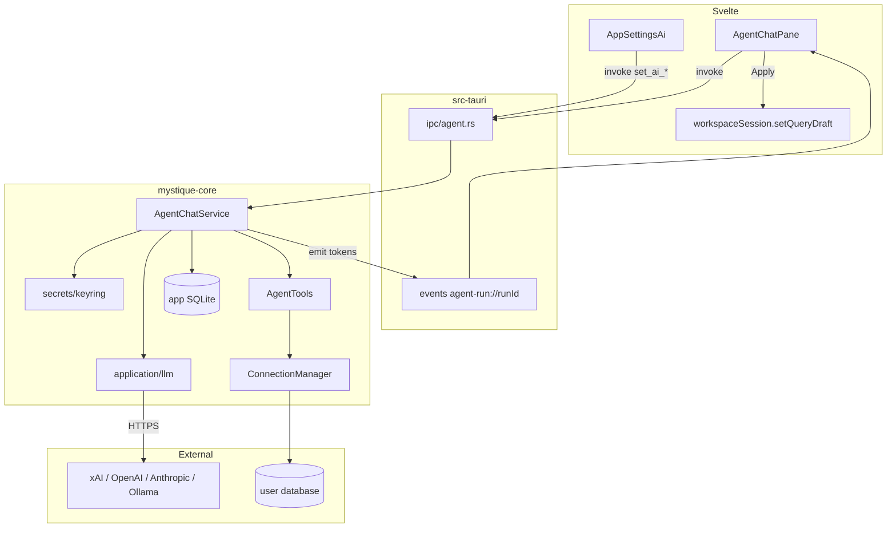

# Query-tab embedded chat agent (NL → draft query)

| Field | Value |
| --- | --- |
| **Status** | Approved |
| **Author** | TBD |
| **Date** | 2026-08-16 |
| **Repo** | `/Users/yashjohri/Projects/mystique-db` |
| **Audience** | Senior engineers implementing PRs 1–8 |
| **Related** | PRD §7.7 (A-1–A-10), `docs/SQLITE_SCHEMA.md`, `docs/BACKEND_STRUCTURE.md` |

---

## Overview

Query tabs today are a vertical editor/results split (`QueryCanvas`) with no assistant. Users who want NL → SQL/MQL leave Mystique, paste schema into ChatGPT, and paste a query back — losing connection policy, audit, and the DBML already produced by `AgentTools::get_schema_dbml`.

This design adds an **opt-in right-hand chat pane on query tabs**. The in-app agent lives in `mystique-core` (not `mystique-mcp`), streams from a user-chosen LLM (default **xAI `grok-4.5`**), and calls the **same** `mystique_core::AgentTools` surface MCP already uses. Generated SQL/MQL is a **draft** until the user hits Run in the editor (`workspaceSession.setQueryDraft`). Threads, messages, LLM runs, and tool-call audits persist in local SQLite (`004_agent_chat.sql`). API keys go in the OS keychain — never `app_settings` and never the renderer.

---

## Background & Motivation

### Current state

| Layer | What exists | What does not |
| --- | --- | --- |
| Tools | `crates/mystique-core/src/application/agent_tools.rs` — `call_tool`, `tool_specs()` | In-app caller of `call_tool` |
| MCP | `crates/mystique-mcp/` on `127.0.0.1:17321`; `lib.rs` says in-app agents must **not** HTTP-loopback | Embedded chat loop |
| Query tab | `WorkspaceMainPane` → `QueryCanvas` (vertical split only) | Right column |
| Table tab | Right `RowInspector` (`w-72`) — the layout to mirror | — |
| Settings | `AppSettingsPopover` sections `'appearance' \| 'mcp'`; `mcp.enabled` | `'ai'` section, provider, model, key |
| Secrets | Connection passwords are plaintext in `connections.secret_ref` (“keychain later”) | Real keychain for AI keys |
| SQLite | Migrations `001`–`003`; `app_settings` KV | Chat / run / tool-audit tables |
| FE prefs | Explorer width in `src/lib/utils/appPrefs.ts` | Chat pane width / collapsed |
| IPC | `get_setting` / `set_setting`; no agent commands | Chat + LLM + keychain IPC |

`get_schema_dbml` already builds live DBML from catalog columns + FKs (`application/dbml.rs`), capped at 200 tables, no comments/indexes/defaults, and **never** returns host/password/URI. `execute_readonly_query` already forces `QueryMode::Read` + `profile_read_only: true`, `AGENT_DEFAULT_ROWS = 200`, `AGENT_MAX_ROWS = 2_000`, 30s timeout.

### Pain points

1. Schema context is a copy-paste tax; the product already has it.
2. External chat ignores connection read-only / query policy.
3. No audit of what an assistant read or ran.
4. MCP exists for Cursor-class clients; desktop users who stay in the query tab get nothing.
5. Putting API keys in SQLite (or repeating the plaintext `secret_ref` mistake) would violate PRD security and `SQLITE_SCHEMA.md` §3.2.

---

## Goals & Non-Goals

### Goals (v1)

- Right chat pane on **query** tabs only: collapse/expand, resizable, width persisted in `appPrefs`.
- NL → **draft** SQL/MQL using live DBML for the **active connection**.
- User picks **provider** in Settings; picks **model** in the chat (filtered by that provider).
- Persist threads (per connection), messages, LLM run telemetry, and redacted tool-call audit.
- In-app agent calls `AgentTools::call_tool` **directly** (A-2 interpreted as same tool *surface*, not HTTP to `mystique-mcp`).
- Opt-in: master `ai.enabled` turns **both** in-app agent and MCP off (A-4). New installs default off; existing MCP users are grandfathered (D3). Sub-toggles `agent.enabled` and `mcp.enabled` still exist.
- Secrets in OS keychain; FE never holds the raw key (A-7).
- Apply-to-editor is explicit; agent never auto-Runs the editor query (A-8).
- In-app loop uses an **allowlist** of read tools; `save_query` is not auto-invoked (A-8).

### Non-goals (v1)

- Auto-execute generated queries as the user’s Run.
- Write / DDL / DELETE via the agent (`execute_readonly_query` remains read-only).
- MCP as a separate principal (A-10).
- Duplicating tool business logic in the chat crate or via localhost HTTP.
- Fine-tuning, RAG indexes, or storing full DBML snapshots per message.
- Chat on table / model / structure tabs.
- Migrating connection passwords onto keychain (separate project).
- Billing / cost dashboards (column reserved only).
- Multi-agent / multi-user / cloud sync of threads.

---

## Key Decisions

| # | Decision | Rationale |
| --- | --- | --- |
| D1 | Chat orchestration lives in **`mystique-core`** (`application/agent_chat.rs` + `application/llm/`), **not** `mystique-mcp`. **A-2** is interpreted as the same tool *surface* (`tool_specs` / `call_tool`), not HTTP to `mystique-mcp`. Amend PRD A-2 wording when convenient. | Codebase rule + `mystique-mcp/src/lib.rs`: in-app agents call `AgentTools` directly. MCP stays an HTTP adapter for external clients. |
| D2 | Relax BACKEND_STRUCTURE “core must not HTTP” **only** for outbound LLM, and document that exception **in the same PR that adds `reqwest`**. Still no MCP/Axum in core. Extract to `mystique-agent` later if review wants core HTTP-free (Alternative D). | Persistence + `AgentTools` already live in core. A crate split is mechanical (module paths match) and is not required to start. |
| D3 | **Master `ai.enabled` gates both features.** New installs: unset/`false` (no MCP, no LLM). **Grandfather:** first read of `ai.enabled` when the row is missing **and** `mcp.enabled` is true persists `ai.enabled=true` so already-shipped MCP keeps running after PR 1. Sub-toggles: `agent.enabled` (in-app LLM) and existing `mcp.enabled`. Turning `ai.enabled` off stops MCP and refuses in-app runs. `set_mcp_enabled(true)` while master is off **must not** start the server and **must not** write `mcp.enabled` — return `"AI features are off"` so the FE can `openAppSettings('ai')`. | Satisfies P0 A-4 without silently disabling existing MCP users. Kill switch / rollback is `ai.enabled`, not `agent.enabled`. |
| D4 | Threads are **per-connection**. `workspace_tab_id` is a nullable hint, **no FK**. `database` is stored on the thread and bound into tools. | Many query tabs per connection (`openNewQuery` uses `${connectionId}::query::${uuid}`). Tabs are ephemeral strings replaced via `replace_workspace_tabs`. Threads survive tab close. |
| D5 | Default provider **xAI** (`https://api.x.ai/v1`), default model **`grok-4.5`**, env-style name `XAI_API_KEY`. | Hard product constraint A-7. SKUs in `models.rs` / `models.ts` are a starting catalog; unknown ids are sent through. |
| D6 | New AI keys use **`keyring`**, service `dev.mystique.db`, account `ai.api_key.<provider>`. Never SQLite. | Do not copy plaintext `secret_ref`. `docs/SQLITE_SCHEMA.md` already forbids API keys in `app_settings`. |
| D7 | Draft apply is **FE-only**: parse fenced ```sql / ```mql, store `draft_body` on the assistant message, user clicks **Apply to editor** → `workspaceSession.setQueryDraft(tab.id, …)` **and bump `QueryCanvas` `draftEpoch`**. | A-8. No new AgentTools method in v1. |
| D8 | Agent **may** call `execute_readonly_query` to probe/validate (capped, read-only, max **3 probes/run**). That is **not** the user’s Run and does **not** write `query_history`. Empty-state copy discloses probes. | Tools already exist; probing improves drafts. Editor Run remains the official execution + history path. |
| D9 | Tool `connection_id` **and** `database` are **forced** to the thread’s values. Mismatch → tool error. | Prevents a prompt-injected model from reading another profile or another catalog on the same credential. |
| D10 | Schema is injected by the orchestrator from a **process-wide cache on `AgentRuntime`**, not by hoping the model calls `get_schema_dbml`. Model can still call it / `list_objects` / `describe_object` for overflow. | First-token quality. Cache must outlive a single IPC call (`agent_chat()` accessors are ephemeral). Store `schema_hash` on the run, not the full DBML. Schema inject may `ensure_session` (reconnect). |
| D11 | Chat pane is keyed by **`WorkspaceTab.id` + `connectionId`**, not connection alone. On remount, **re-attach** to any live run on the bound thread (D16). `{#key}` is not a cancellation boundary. | Multiple query tabs must not share composer/UI state, but streams live in `AgentRuntime`. |
| D12 | One active run per thread, enforced in **one `with_conn` transaction** via `agent_threads.active_run_id` + reject if set. Crash repair (`interrupted`) runs at `AgentRuntime` init **before** any send (PR 2/4, not deferred to hygiene). | Check-then-insert across two IPC calls races; `AppDatabase` only serializes if both live in one `with_conn`. |
| D13 | Retention in **app code**, not triggers: 50 threads **per connection** (not the global `retain_latest` query); messages CASCADE with threads; runs/tool_calls older than 90 days pruned. **Chips survive** via tool-role message columns after run prune (`get_agent_run` is `NotFound`). IDs are UUID v4. | Same *pattern* as history (app code, not triggers), different query. |
| D14 | In-app loop **allowlists** tools: `get_schema_dbml`, `list_objects`, `describe_object`, `execute_readonly_query`, `list_saved_queries`. MCP `tool_specs()` unchanged (A-3 = same *available* tools, not same *enabled* set per caller). `save_query` and `list_connections` are **not** called by the in-app loop. | A-8: `save_query` is a write. Prompt text is not enforcement. `list_connections` leaks other profile ids. |
| D15 | **`AgentRuntime` is long-lived** (`Arc` on `AppState` next to `services` and `mcp`): schema cache, in-flight `runs` map (`RunHandle` includes `partial_text`), cancel watches. `AppServices::agent_chat()` stays a short-lived CRUD helper. `with_conn` is never held across `reqwest` or `AgentTools` awaits. | Accessors in `application/mod.rs` return ephemeral structs; a cache on them is a no-op. |
| D16 | Remount **re-subscribes**. Live tokens live in `RunHandle.partial_text` (not SQLite). On mount: resolve thread → if `active_run_id`, `get_agent_run` (includes `partialContent` + `toolCalls`) + `listen` + hydrate the assistant bubble from **`partialContent`**, then append further `token` events. Other tabs may **view** a live thread read-only; only the locking `workspace_tab_id` may `send`. | D4 + D11 tension. Mid-stream there is no assistant row yet; remount must not depend on `list_agent_messages` for tokens. |
| D17 | Hard-cap **8 tool rounds / run** and **3 `execute_readonly_query` calls / run**. `max_tokens` 4096. On cap: stop, persist partial assistant text, `error='tool_round_limit'`, emit `done`. | Unbounded loop + D8 probes can hammer the user DB and the cloud API. D12 only blocks a second *parallel* run. |
| D18 | Conversation window is a **byte budget**, not tokens: last 20 messages **and** ≤ **48 KiB** of concatenated content, whichever first. Tool rows collapse to `{tool, ok, n}`. No tokenizer in v1. | There is no `tiktoken` in the tree; “16k tokens” is not implementable. |

---

## Proposed Design

### 1. UX

#### 1.1 Placement

Mirror the table-tab `RowInspector` pattern in `WorkspaceMainPane.svelte`.

Today (query branch):

```svelte
{#if activeSession && activeTab?.kind === 'query'}
  {#key activeTab.id}
    <QueryCanvas … />
  {/key}
```

v1:

```svelte
{#if activeSession && activeTab?.kind === 'query'}
  {#key activeTab.id}
    <div class="flex min-h-0 min-w-0 flex-1">
      <div class="flex min-h-0 min-w-0 flex-1 flex-col">
        <QueryCanvas
          … 
          draftEpoch={workspaceSession.queryDraftEpochs[activeTab.id] ?? 0}
        />
      </div>
      <AgentChatPane
        tabId={activeTab.id}
        connectionId={activeSession.profile.id}
        connectionName={activeSession.profile.name}
        engine={String(activeSession.profile.engine)}
        database={currentDatabaseName}
        profileReadOnly={!!activeSession.profile.readOnly}
        language={queryLanguageFor(
          String(activeSession.profile.engine),
          activeSession.capabilities,
        )}
      />
    </div>
  {/key}
```

`QueryCanvas` has **no `class` prop** today — wrap it in a `min-w-0 flex-1` div; do not invent one.

`{#key activeTab.id}` remounts canvas + pane so **composer and local UI state** reset per tab. It is **not** a cancellation boundary (D16). `AgentRuntime` keeps the HTTP stream alive. On mount the pane **must**:

1. Resolve thread: `workspace_tab_id = tab.id` if that thread exists → else latest `updated_at` for `connection_id` (do not auto-steal a thread that another tab has locked with a live run).
2. `list_agent_messages` (finished user/tool/assistant rows). If the thread has `activeRunId`, `get_agent_run` (includes `partialContent` + `toolCalls`) and `listen('agent-run://'+runId)`.
3. Hydrate the in-flight assistant bubble from **`get_agent_run.partialContent` only** (D16). Then append further `token` events. Do **not** wait for `done` to replace the bubble, and do **not** expect `list_agent_messages` to contain tokens while `status` is `pending`/`streaming`.
4. Hydrate chips from `toolCalls` if the run still exists, else from tool-role messages (chips **survive** 90-day run prune).

While a run is live, `active_run_id` + `workspace_tab_id` lock the thread to that tab for **Send**. Other query tabs on the same connection may open the thread **read-only** (transcript + chips, composer disabled with “Generating in another tab”).

#### 1.2 Pane chrome

| Behavior | Spec |
| --- | --- |
| Default width | 320px (between inspector `w-72` = 288 and explorer default 240) |
| Range | 280–480px (`AGENT_CHAT_PANEL_WIDTH_MIN/MAX`) |
| Persist | `localStorage` key `mystique-agent-chat-panel-width` via `appPrefs.ts` (same helpers as explorer) |
| Collapsed | 28px rail with “Ask” icon; persist `mystique-agent-chat-collapsed` |
| Resize | Drag left border (copy `WorkspaceSidePane` drag) |
| Disabled agent | Pane **still visible**. Empty state + **Enable in Settings** CTA. No hide-the-feature. |
| Browser (`!isTauri()`) | Same pane, copy: “Agent requires the desktop app (`npm run tauri dev`).” |

#### 1.3 Layout inside the pane

```
┌─────────────────────────────────────┐
│ Agent          [model ▾] [⋯] [–]   │  header
├─────────────────────────────────────┤
│ Threads (this connection)      [+]  │  collapsible list
│  • Orders last 30d                  │
│  • Untitled                         │
├─────────────────────────────────────┤
│ messages (scroll)                   │
│  user / assistant / tool chips      │
├─────────────────────────────────────┤
│ [Apply] [Copy] [Save] on last draft │
│ composer  [Stop] / [Send]           │
└─────────────────────────────────────┘
```

- **Header:** title “Agent”, model `<Select>` (existing UI primitive), overflow (rename / delete thread), collapse.
- **Thread list:** per **connection**, newest `updated_at` first. Click focuses thread and writes `workspace_tab_id` so this tab resumes it.
- **Messages:** user markdown-ish text; assistant streamed tokens; tool chips (not raw JSON).
- **Composer:** textarea, Enter send / Shift+Enter newline, disabled when `!agent.enabled` or run streaming (unless Stop).
- **Stop:** `cancel_agent_run`.

#### 1.4 Model picker

- Settings owns **provider** (+ base URL for `openai_compat`, API key).
- Chat picker lists models for **that provider only**.
- Changing provider in Settings resets the picker to `ai.model.<provider>` or the provider default.
- Persist last model per provider in `app_settings` (`ai.model.xai`, …).

#### 1.5 Actions (A-8)

| Action | Behavior |
| --- | --- |
| **Apply to editor** | `workspaceSession.setQueryDraft(activeTab.id, draftBody)` **and increment `queryDraftEpochs[tabId]`**. `QueryCanvas` takes `draftEpoch` and, when it changes, copies `text` into `localText` even if the editor is focused. Does **not** call `executeEngineQuery`. |
| **Copy** | Clipboard the draft (or full assistant text if no draft). |
| **Save query** | **Disabled until Apply.** Then the existing FE path: `SaveQueryModal` collects a **name only**; `WorkspaceShell.saveQueryTab` persists `workspaceSession.queryDrafts[tab.id]` (the **editor** buffer). Do not claim the modal accepts a body. Do not call the `save_query` tool from the pane. |
| **Stop** | `cancel_agent_run`. Unknown `runId` → `NotFound` (string error, not HTTP 409). |

The assistant message stores `draftBody` / `draftLanguage` extracted from the last ` ```sql ` / ` ```mql ` (or ` ```javascript ` for MQL) fence. If none, Apply (and therefore Save) is hidden.

**First Send:** if the pane has no `threadId`, `send_agent_message` accepts `connectionId` + optional `threadId` + `database` and **auto-creates** a thread (title `'New chat'`, `database` = pane `currentDatabaseName` or `""`). The orchestrator then sets `title` to the first user message trimmed to 60 chars if still `'New chat'`. `[+]` calls `create_agent_thread({ connectionId, workspaceTabId, database: currentDatabaseName ?? '' })` — never create a thread with SQL NULL `database`.

#### 1.6 Empty / disabled states

**Disabled (`ai.enabled = false` or `agent.enabled = false`):**

> In-app Agent is off. Enable it under Settings → Agent to generate draft queries from this connection’s schema. Mystique will not call an LLM until you opt in. (MCP is a separate localhost server under Settings → MCP; the master “AI features” switch turns both off.)

Primary button calls `openAppSettings('ai')` — a tiny store (`src/lib/stores/app-settings.svelte.ts`) that `AppSettingsPopover` subscribes to (`open` + `section`). The popover today owns `open`/`section` and resets to `'appearance'` on gear toggle; it has **no** `openTo` export. Add the store in PR 1 so PR 6’s CTA can use it.

**Enabled, no threads / empty thread:**

> Describe the query you need. Mystique will read this connection’s schema (DBML) — this may reconnect the profile if the session is dead — and propose SQL/MQL in the editor. Mystique may run **read-only probes** to check a draft; your editor query runs only when you click Run.

Suggestions (chips, insert into composer): “Rows created in the last 30 days”, “Count by status”, “Explain the tables that reference customers”.

#### 1.7 Tool-call chips (no secrets)

| Tool | Chip copy |
| --- | --- |
| `get_schema_dbml` | Fetched schema (DBML) |
| `list_objects` | Listed N objects |
| `describe_object` | Described `schema.name` |
| `execute_readonly_query` | Probed N rows (read-only) |
| `list_saved_queries` | Listed saved queries |
| `list_connections` | Listed connections |
| `save_query` | Saved “name” |
| error | Tool failed: short message |

Clicking a chip expands a **redacted** summary (row count, duration, truncated preview). Never host, URI, password, API key. After remount, chips are rebuilt from tool-role `AgentMessage` fields and/or `get_agent_run.toolCalls` (see API).

#### 1.8 Streaming

Tokens append to a local assistant bubble as Tauri events arrive. A blinking caret while `status === 'streaming'`. On `done`, persist from the event payload (server is source of truth; FE reconciles via `list_agent_messages`).

#### 1.9 Keyboard

| Shortcut | Action |
| --- | --- |
| `⌘/Ctrl+Shift+L` | **Focus the composer** (opens/expands the pane if collapsed). Not a toggle. Document in `KeyboardShortcutsModal`. |
| Enter | Send |
| Shift+Enter | Newline |
| Esc | Stop if streaming, else blur |

Do **not** steal `⌘W` / `⌘T` / `⌘S` (`workspaceShortcuts.ts`).

---

### 2. Architecture

#### 2.1 Layering



**Hard rules**

- FE never reads the API key. `get_ai_settings` returns `hasApiKey: boolean`.
- In-app path: `AgentChatService` → `AgentTools::call_tool`. **No** `reqwest` to `127.0.0.1:17321`.
- MCP path unchanged: `McpService` → same `AgentTools`.
- `src-tauri/src/ipc/agent.rs` is a thin adapter (same as `ipc/history.rs`).

#### 2.2 New / touched modules

```
crates/mystique-core/
  migrations/004_agent_chat.sql
  src/
    secrets/mod.rs                 # keyring wrapper
    application/
      agent_chat.rs                # orchestrator
      agent_redact.rs              # shared redaction
      llm/
        mod.rs                     # LlmProvider trait
        openai_compat.rs           # xAI, OpenAI, generic
        anthropic.rs
        models.rs                  # static catalogs
    domain/agent_chat.rs           # DTOs
    storage/sqlite/
      migrate.rs                   # register 4
      repositories/agent_chat.rs

src-tauri/src/ipc/agent.rs
src-tauri/src/lib.rs               # register commands + AgentRuntime state

src/lib/api/agent.ts
src/lib/components/ui/AppSettingsAi.svelte
src/lib/components/ui/AppSettingsPopover.svelte   # section 'ai'
src/lib/components/workspace/agent/
  AgentChatPane.svelte
  AgentThreadList.svelte
  AgentMessageList.svelte
  AgentComposer.svelte
  AgentToolChip.svelte
src/lib/utils/appPrefs.ts          # width + collapsed
src/lib/components/workspace/shell/WorkspaceMainPane.svelte
```

#### 2.3 Runtime state (Tauri) — D15

`AppDatabase` is `Mutex<Connection>` — fine for short CRUD, **not** for holding an HTTP stream or `get_schema_dbml` lock. `AppServices::agent_chat()` (like `history()` / `settings()`) returns an **ephemeral** struct with `&AppDatabase`. A cache on that struct dies every IPC call.

Own long-lived state on **`AgentRuntime`**, stored as `Arc<AgentRuntime>` on `AppState` next to `services` and `mcp`:

```rust
// mystique-core/src/application/agent_runtime.rs
pub struct AgentRuntime {
    pub db: Arc<AppDatabase>,
    pub tools: AgentTools, // clone of handles; does not hold the SQLite mutex
    pub schema_cache: tokio::sync::Mutex<HashMap<SchemaCacheKey, SchemaCacheEntry>>,
    pub runs: tokio::sync::Mutex<HashMap<String, RunHandle>>,
}

pub struct SchemaCacheKey {
    pub connection_id: String,
    pub database: String, // "" if none
}

pub struct SchemaCacheEntry {
    pub dbml: String,
    pub hash: String, // sha256 hex
    pub fetched_at: std::time::Instant,
    pub table_count: usize,
}

struct RunHandle {
    cancel: tokio::sync::watch::Sender<bool>,
    thread_id: String,
    workspace_tab_id: Option<String>,
    /// All assistant tokens so far. Source of truth for remount (D16).
    partial_text: String,
}

impl AgentRuntime {
    /// Flip pending|streaming → error='interrupted', clear threads.active_run_id.
    /// Call once from Tauri `setup` after AppDatabase::open, before any send.
    pub fn repair_interrupted(&self) -> AppResult<u64>;
}
```

```rust
// src-tauri/src/lib.rs
pub struct AppState {
    pub services: Arc<AppServices>,
    pub mcp: McpService,
    pub agent: Arc<AgentRuntime>,
}
```

`with_conn` is used **only** for short CRUD (insert message, insert run, prune). Never held across `reqwest` or `AgentTools` awaits (`ensure_session` / catalog / execute).

#### 2.4 Chat loop

```mermaid
sequenceDiagram
  participant FE as AgentChatPane
  participant IPC as ipc/agent
  participant Chat as AgentChatService
  participant Key as SecretStore
  participant LLM as LlmProvider
  participant Tools as AgentTools
  participant DB as SQLite

  FE->>IPC: send_agent_message(connectionId, threadId?, tabId, text, model?)
  IPC->>Chat: start_run(...)
  Chat->>DB: one with_conn: create thread if needed; reject if active_run_id set; insert user msg + run(pending); set active_run_id
  Chat->>Chat: ensure_schema(connection) via get_schema_dbml
  Chat->>Key: get_ai_key(provider)
  loop stream
    Chat->>LLM: chat.completions / messages (SSE)
    LLM-->>Chat: token / tool_call
    Chat-->>FE: emit agent-run://runId
    opt tool_call
      Chat->>DB: insert agent_tool_calls(args redacted)
      Chat->>Tools: call_tool(name, args with forced connection_id)
      Tools-->>Chat: JsonValue
      Chat->>DB: update tool row (result redacted, truncated)
      Chat->>LLM: tool result (redacted)
    end
  end
  Chat->>DB: insert assistant msg (draft extracted), finish run
  Chat-->>FE: emit done { message, draft, usage }
```

**System prompt (sketch)** — built in Rust, never from the FE:

- You are Mystique DB’s query assistant for connection `{name}`, engine `{engine}`, database `{database}`, language `{sql|mql}`.
- Propose a single draft query in a fenced ` ```sql ` or ` ```mql ` block.
- Use schema-qualified names from the DBML Table headers (e.g. `main.boards`). Only `public` may be unqualified.
- Do **not** invent tables/columns. If missing, call `list_objects` / `describe_object`.
- You may `execute_readonly_query` to sanity-check; writes are rejected.
- Never ask the user to paste schema, hosts, or passwords.
- Never echo secrets. Connection id is `{id}` — always use it.
- The user must Apply + Run; you do not execute their editor query.

**Conversation window (D18):** last 20 messages **and** ≤ 48 KiB of concatenated `content`, whichever first. Older tool-role rows collapse to `{tool, ok, n}` using `tool_name` / status on the message (not a tokenizer).

**Tool-loop cap (D17):** max **8** `ChatEvent::ToolCall` rounds per run; max **3** successful or failed `execute_readonly_query` calls. On cap: do not send another completion request; persist partial assistant text; `agent_runs.error = 'tool_round_limit'`; `status = 'error'`; clear `active_run_id`; emit `done`. System prompt states the caps. Unit test: mock provider that requests a 9th tool → cut off, no 9th `call_tool`.

**Concurrency (D12):** not a loose SELECT-then-INSERT across awaits. **One `with_conn` transaction:**

```sql
-- inside with_conn
SELECT active_run_id FROM agent_threads WHERE id = ?1;
-- if active_run_id IS NOT NULL → AppError::Invalid("run already in progress")
INSERT INTO agent_messages (... user ...);
INSERT INTO agent_runs (id, thread_id, status, ...) VALUES (?, ?, 'pending', ...);
UPDATE agent_threads SET active_run_id = ?run, workspace_tab_id = ?tab, updated_at = ?now WHERE id = ?1;
```

Then drop the lock and stream. On each `ChatEvent::Token`, **append to `RunHandle.partial_text`** (in-memory; not SQLite). Persist **tool rows** in separate short `with_conn`s as they complete. On finish/cancel/error: insert the **assistant** message with `content = partial_text` (plus extracted draft), `UPDATE agent_runs` (`message_id`, status, usage), `UPDATE agent_threads SET active_run_id = NULL`, drop the handle.

`get_agent_run` while the handle exists returns `partialContent: handle.partial_text`. After the handle is gone, `partialContent` is null and the assistant row (if any) has the final text. Mid-stream remount **must** use `partialContent`, not `list_agent_messages`.

IPC maps `Invalid("run already in progress")` to the **string** `"run already in progress"` (Tauri commands return `Result<T, String>`, not HTTP 409). FE shows that string.

`cancel_agent_run`: if `runId` not in `AgentRuntime.runs` and DB row is not `pending|streaming` → `NotFound("run not found")`.

**Cancel:** FE → `cancel_agent_run` → `watch` flag → drop reqwest stream → persist `cancelled` + partial assistant text → clear `active_run_id`.

**Crash repair:** `AgentRuntime::repair_interrupted` at process start (PR 2 ships the SQL; PR 4 calls it from `setup` before any send):

```sql
UPDATE agent_runs
   SET status = 'error', error = 'interrupted', finished_at = ?now
 WHERE status IN ('pending', 'streaming');
UPDATE agent_threads SET active_run_id = NULL WHERE active_run_id IS NOT NULL;
```

#### 2.5 Schema injection (D10)

Cache lives on **`AgentRuntime.schema_cache`** (process-wide, 10-minute TTL), not on the ephemeral `AgentChatService`.

```text
cache key = (connection_id, thread.database.unwrap_or(""))
TTL       = 10 minutes
value     = { dbml, sha256, fetched_at, table_count }
```

On first message of a run:

1. Cache hit and age < TTL → reuse.
2. Else `AgentTools::get_schema_dbml(connection_id, database)` — **this calls `ensure_session`**, which opens a pooled session (password from plaintext `secret_ref`) if the query tab’s session is dead. First chat message is therefore a **connect side effect**. Prefer the live workspace session when one exists (`session_id == profile.id` already). Empty-state copy discloses this. Optional later: pass `engineSessionId` as a hint; v1 leaves `ensure_session` as-is.
3. If `dbml.len() > SCHEMA_CONTEXT_MAX` (**80 KiB**): keep Table headers, PK/not-null columns, `Ref:` lines; drop other columns; append “Use list_objects / describe_object for the rest.”
4. Inject as a **system** message (not a persisted `agent_messages` row).
5. Store `schema_hash` on `agent_runs`. Do **not** persist the DBML blob.

Refresh cache when the user clicks a “Refresh schema” overflow item, when the workspace database changes (update `agent_threads.database` + invalidate cache key), or when the model is allowed to call `get_schema_dbml`.

**Never** send `plugin_config`, host, URI, username, or password. `AgentConnectionInfo` is already safe (id, name, engine, database, read_only, connected).

**PR 4 assertion:** probes and schema inject must **not** call `append_query_history`. History is only written by `QueryCanvas` → `append_query_history`. The useful unit test is “chat loop never calls `connections.execute_query` except via `AgentTools`,” not “execute without Read” (`execute_readonly_query` already hard-codes `QueryMode::Read` + `profile_read_only: true`).

#### 2.6 Using existing AgentTools (do not fork)

`AgentChatService` / `AgentRuntime` is the first in-app caller of `AgentTools::call_tool`. MCP continues to call the same method (`crates/mystique-mcp/src/server.rs`).

**In-app allowlist (D14)** — the loop only *advertises and dispatches* these names. MCP `tool_specs()` is unchanged (A-3: same *available* product tools, not the same enabled set per caller).

| Tool | In-app loop | MCP |
| --- | --- | --- |
| `get_schema_dbml` | Yes — orchestrator preload + model overflow | Yes |
| `list_objects` | Yes | Yes |
| `describe_object` | Yes | Yes |
| `execute_readonly_query` | Yes — probe, max 3/run (D8, D17) | Yes |
| `list_saved_queries` | Yes | Yes |
| `save_query` | **No** — FE Save after Apply (A-8) | Yes |
| `list_connections` | **No** — orchestrator already binds the thread connection | Yes |

Unknown / denied tool name → persist `agent_tool_calls.status='error'`, return a tool-error to the model (`unknown or disabled tool`), do not call `call_tool`.

**No v1 additions to `tool_specs()`.** Apply-to-editor is not a tool.

**Forced args** before `call_tool` (D9):

```rust
fn bind_thread_scope(
    args: &mut Value,
    connection_id: &str,
    database: &str, // thread.database; "" if the pane had no catalog
) -> AppResult<()> {
    // connection_id: inject if missing; reject mismatch
    // database: always inject thread.database (including "").
    //           reject if the model supplied a different non-empty value.
    Ok(())
}
```

`agent_threads.database` is **NOT NULL** in practice: create / first send stores `currentDatabaseName` or `""`. Update it when the user changes the workspace database on a thread they own (invalidate schema cache). Never leave it SQL NULL.

**Redaction** (`application/agent_redact.rs`) before persist **and** before sending tool results back to the model. Two layers:

1. **Mystique connection secrets** are already omitted by `AgentTools` (`AgentConnectionInfo` has no host/password/URI). This pass is for **result payloads**.
2. **Column-aware result redaction** — `execute_readonly_query` returns `AgentQueryDownload`: `columns: Vec<String>` plus **positional** `rows: Option<Vec<Vec<JsonValue>>>` or `csv: Option<String>`. Key-based deletion on row objects will **not** strip a `password` column.

Algorithm:

- Secret column/key regex: `(?i)(password|secret|token|api[_-]?key|authorization|uri|connection_string)`.
- **JSON rows:** zip `columns[i]` with `row[i]`; replace matching cells with `"***"`. Recurse into object-shaped cells and drop/replace matching keys.
- **CSV:** parse header line; replace cells in secret-named columns with `***`.
- Strip `postgres://`, `mysql://`, `mongodb://` URIs in any remaining string via regex.
- Keep at most **20 rows** (or 20 CSV data lines) for the model and for `result_json`.
- Truncate JSON to **32 KiB**; add `"_truncated": true`.
- Persist the **same** redacted form in `agent_tool_calls.result_json`.

Fixture test (PR 4): `columns = ["id","password","api_key"]`, one row `["1","hunter2","sk-live"]` → cells 1 and 2 are `***` in both model context and `result_json`. Key-only redaction of this payload must fail the test.

`args_json` still uses key-based redaction (tool args are objects).

#### 2.7 Provider adapters (A-7)

```rust
#[async_trait]
pub trait LlmProvider: Send + Sync {
    async fn stream_chat(
        &self,
        req: ChatRequest,
        cancel: watch::Receiver<bool>,
    ) -> AppResult<Pin<Box<dyn Stream<Item = AppResult<ChatEvent>> + Send>>>;

    async fn list_models(&self) -> AppResult<Vec<LlmModelInfo>>;
}

pub struct ChatRequest {
    pub model: String,
    pub messages: Vec<ChatMessage>, // system | user | assistant | tool
    pub tools: Vec<AgentToolSpec>,
    pub temperature: f32,
    pub max_tokens: u32, // default 4096
}

pub enum ChatEvent {
    Token(String),
    ToolCall { id: String, name: String, arguments: JsonValue },
    Usage { prompt_tokens: u32, completion_tokens: u32 },
    Done { request_id: Option<String> },
}
```

| Provider id | Adapter | Default base URL | Default model | Key env-style |
| --- | --- | --- | --- | --- |
| `xai` | OpenAI-compatible | `https://api.x.ai/v1` | `grok-4.5` | `XAI_API_KEY` |
| `openai` | OpenAI-compatible | `https://api.openai.com/v1` | `gpt-4.1` | `OPENAI_API_KEY` |
| `anthropic` | Messages API + SSE | `https://api.anthropic.com` | `claude-sonnet-4-5` | `ANTHROPIC_API_KEY` |
| `openai_compat` | OpenAI-compatible | **required** `ai.baseUrl` | user / `/v1/models` first | optional (Ollama often none) |

**HTTP:** add `reqwest` (rustls-tls, json, stream) + `futures-util` to `mystique-core`. Timeouts: connect 10s, first-byte 30s, overall 120s.

**Auth:** `Authorization: Bearer <key>` for OpenAI-compat; `x-api-key` + `anthropic-version` for Anthropic.

**Local:** `openai_compat` with `http://127.0.0.1:11434/v1` (Ollama) or LM Studio / vLLM. Empty key allowed **only** for this provider.

**`ai.baseUrl` validation (not vacuous “user typed it”):** scheme `http` or `https` only; reject `file:`, `ftp:`, credentials-in-URL; reject host `169.254.169.254` and metadata IPs (`metadata.google.internal`). Warn in Settings (non-blocking) when host is not loopback. The URL used at send time is **only** `ai.baseUrl` from settings — `send_agent_message` must not accept a base URL.

**Static catalogs** — ship the same list in `application/llm/models.rs` **and** `src/lib/data/agentModels.ts` (PR 1 uses the TS file so Settings `<Select>` works before PR 3/5). Offline picker:

- xAI: `grok-4.5`, `grok-4`, `grok-3`, `grok-3-mini`
- OpenAI: `gpt-4.1`, `gpt-4.1-mini`, `gpt-4o`, `o4-mini`
- Anthropic: `claude-sonnet-4-5`, `claude-opus-4-5`, `claude-haiku-4-5`

`list_agent_models` unions static + optional live `GET {base}/models` (ignore auth failures; still return static). Unknown model ids are allowed (user-typed / new SKU) — send through, let the provider 404.

**Temperature** default `0.2` (`ai.temperature`).

#### 2.8 Secret store (D6)

New module `crates/mystique-core/src/secrets/mod.rs`:

```rust
pub const KEYRING_SERVICE: &str = "dev.mystique.db";

pub struct SecretStore;

impl SecretStore {
    pub fn ai_key_account(provider: &str) -> String {
        format!("ai.api_key.{provider}")
    }
    pub fn set_ai_key(provider: &str, secret: &str) -> AppResult<()>;
    pub fn get_ai_key(provider: &str) -> AppResult<Option<String>>;
    pub fn delete_ai_key(provider: &str) -> AppResult<()>;
    pub fn has_ai_key(provider: &str) -> bool;
}
```

- Crate: `keyring = "3"` (macOS Keychain, Windows Credential Manager, Linux Secret Service).
- Linux headless fallback: return `AppError::Invalid("OS secret store unavailable")` — do **not** write a plaintext file.
- `set_ai_api_key` with empty string deletes.
- Never log the secret. `Debug` on settings structs omits it.
- IPC `get_ai_settings` returns only `hasApiKey`.
- If `XAI_API_KEY` / `OPENAI_API_KEY` / `ANTHROPIC_API_KEY` is in the process env and keychain is empty, use env for the run but **do not** persist unless the user saves in Settings.
- `AiSettingsView.keySource`: `'keychain' | 'env' | 'none'`. `hasApiKey` is `keySource != 'none'` for cloud providers; for `openai_compat`, `hasApiKey` may be false and that is **normal** (empty key allowed). Cloud send with `keySource == 'none'` → `Invalid("API key not set for provider")`.

#### 2.9 Settings keys (`app_settings`)

| Key | Default | Notes |
| --- | --- | --- |
| `ai.enabled` | `false` | **Master** (A-4). Off → stop MCP if running; refuse `start_run`; no LLM HTTP. |
| `agent.enabled` | `false` | In-app LLM. Effective only if `ai.enabled`. |
| `mcp.enabled` | `false` | Existing. `McpService::start` also requires `ai.enabled`. |
| `ai.baseUrl` | `""` | Required for `openai_compat` |
| `ai.defaultModel` | `grok-4.5` | Fallback |
| `ai.model.xai` | `grok-4.5` | Last-used per provider |
| `ai.model.openai` | `gpt-4.1` | |
| `ai.model.anthropic` | `claude-sonnet-4-5` | |
| `ai.model.openai_compat` | `""` | |
| `ai.temperature` | `0.2` | |

**Never** `ai.apiKey`. Existing `mcp.enabled` / `mcp.port` / `mcp.token` unchanged.

`AppSettingsPopover` section type becomes `'appearance' | 'ai' | 'mcp'`. New `AppSettingsAi.svelte` + `src/lib/stores/app-settings.svelte.ts` (`openAppSettings(section)`):

- Switch **AI features** (`ai.enabled`) — “Turns off in-app Agent and the MCP server.”
- Switch **in-app Agent** (`agent.enabled`) — disabled when `!ai.enabled`.
- Provider `<Select>`.
- Base URL `<Input>` when `openai_compat` (validated on save).
- Default model `<Select>` populated from `src/lib/data/agentModels.ts` (PR 1; Rust twin in PR 3) + free-text override.
- API key `<PasswordInput>` — write-only; placeholder “••••” when `keySource === 'keychain'`. Caption when `keySource === 'env'`: “Using process env (not saved). Save a key to store it in the keychain.” Save calls `set_ai_api_key`. Clear button.
- Short note: “MCP is a separate localhost server for external clients (Settings → MCP). The in-app agent does not use it. The master switch above turns both off (PRD A-4).”

**Effective `ai.enabled` (PR 1, first read):**

```text
let row = settings.get("ai.enabled")?;
if row is None && mcp.enabled is true {
    settings.set("ai.enabled", "true");  // grandfather shipped MCP
    effective = true
} else {
    effective = row == Some("true" | "1")   // missing → false (new install)
}
```

`McpService::start` / `restore_if_enabled` no-op unless **effective** `ai.enabled` is true. Turning `ai.enabled` off calls `mcp.stop()` if it was running.

`set_mcp_enabled(true)` (existing IPC `set_mcp_enabled`) while master is off:

- **Must not** bind the port.
- **Must not** write `mcp.enabled=true` (today `start()` writes then binds — change that order: require master first).
- Return `Err("AI features are off")`. MCP pane shows the error + a button that calls `openAppSettings('ai')`.

`set_mcp_enabled(false)` still stops the server and writes `mcp.enabled=false` regardless of master.

Settings gear still resets to `'appearance'` on manual toggle. `openAppSettings('ai')` from the pane CTA sets `section` then `open = true`.

#### 2.10 FE draft apply (A-8)

```ts
// AgentChatPane — required A-8 path, not optional
function applyDraft(body: string) {
  workspaceSession.setQueryDraft(tabId, body)
  workspaceSession.bumpQueryDraftEpoch(tabId) // queryDraftEpochs[tabId]++
}

// QueryCanvas.svelte — add prop draftEpoch = 0
// $effect: when draftEpoch increases, copy `text` into localText/lastEmitted
// even if document.activeElement is inside [data-query-editor].
// Comment in QueryCanvas: "agent Apply must bump draftEpoch".
```

The existing `$effect` **skips** parent `text` when focus is inside `[data-query-editor="${connectionId}"]`. Clicking Apply usually blurs first; keyboard or programmatic Apply does not. **`draftEpoch` is required in the stream/Apply PR**, not “implementers should extend.”

Apply **replaces** the full draft (v1). Selection-aware insert is v1.x.

Agent probes via `execute_readonly_query` do **not** call `append_query_history` and do **not** change `QueryCanvas` `runState`.

---

## API / Interface Changes

### Tauri commands

Register in `src-tauri/src/lib.rs` next to MCP (comment: in-app agent → AgentTools, not HTTP).

| Command | Args | Returns |
| --- | --- | --- |
| `list_agent_threads` | `{ connectionId }` | `AgentThread[]` ordered by `updatedAt DESC` |
| `create_agent_thread` | `{ connectionId, workspaceTabId?, database? }` | `AgentThread` — pane **always** passes `currentDatabaseName`; store `""` when empty so D9 always has a value |
| `update_agent_thread` | `{ threadId, title?, workspaceTabId? }` | `AgentThread` |
| `delete_agent_thread` | `{ threadId }` | `()` |
| `list_agent_messages` | `{ threadId, afterId?, limit? }` | `AgentMessage[]` |
| `send_agent_message` | `{ connectionId, threadId?, workspaceTabId?, content, model?, database? }` | `{ runId, userMessageId, threadId }` |
| `cancel_agent_run` | `{ runId }` | `{ status }` — `NotFound` if unknown |
| `get_agent_run` | `{ runId }` | `AgentRun` (includes `toolCalls`) — `NotFound` if missing |
| `list_agent_tool_calls` | `{ runId }` | `AgentToolCall[]` |
| `list_agent_models` | `{ provider? }` | `LlmModelInfo[]` |
| `get_ai_settings` | — | `AiSettingsView` |
| `set_ai_settings` | `AiSettingsPatch` | `AiSettingsView` |
| `set_ai_api_key` | `{ provider, apiKey }` | `{ hasApiKey }` |
| `refresh_agent_schema` | `{ connectionId, database? }` | `{ schemaHash, tableCount, bytes }` |

No `apply_agent_draft` IPC — FE applies locally (A-8).

### Events

Channel: `agent-run://{runId}`

```ts
type AgentRunEvent =
  | { type: 'token'; text: string }
  | { type: 'tool_start'; toolCallId: string; toolName: string; summary: string }
  | { type: 'tool_end'; toolCallId: string; toolName: string; ok: boolean; summary: string }
  | { type: 'draft'; body: string; language: 'sql' | 'mql' }
  | { type: 'error'; message: string }
  | {
      type: 'done'
      status: 'ok' | 'error' | 'cancelled'
      messageId?: string
      promptTokens?: number
      completionTokens?: number
      latencyMs: number
    }
```

Event name style: **`agent-run://{runId}`** (one style; do not also emit `agent-run-{id}`). `://` already works in this app (`workspace://new-query`).

Reuse `@tauri-apps/api/event` `listen`. If `listen` registers after the first token, hydrate the bubble from **`get_agent_run.partialContent`** (in-memory `RunHandle`), then append further events. `list_agent_messages` does **not** contain mid-stream tokens. No capability change: Tauri 2 `core:default` already allows invoke/events (`capabilities/default.json`).

### IPC sketch (`src-tauri/src/ipc/agent.rs`)

```rust
#[tauri::command]
pub async fn send_agent_message(
    app: tauri::AppHandle,
    state: State<'_, AppState>,
    input: StartRunInput,
) -> Result<StartRunOutput, String> {
    // ai.enabled && agent.enabled checked inside start_run
    let (out, cancel_rx) = state.agent.begin_run(input).map_err(|e| e.to_string())?;
    let run_id = out.run_id.clone();
    let agent = Arc::clone(&state.agent);
    tauri::async_runtime::spawn(async move {
        let emit = |ev: AgentRunEvent| {
            let _ = app.emit(&format!("agent-run://{run_id}"), ev);
        };
        let _ = agent.start_run_body(run_id, cancel_rx, emit).await;
    });
    Ok(out)
}
```

`begin_run` is the `with_conn` insert (user message + pending run + `active_run_id`) and inserts a `RunHandle { partial_text: "" }`. Errors: `"agent is disabled"`, `"AI features are off"`, `"API key not set for provider"`, `"run already in progress"`, `"run not found"`.

### Rebuilding chips after remount

Chips **survive** 90-day run prune. One rule everywhere (D13):

1. `list_agent_messages(threadId)` — tool-role rows carry `toolCallId`, `toolName`, `status`, `durationMs`, redacted `content` (summary). **This is enough to render chips.**
2. If the run still exists: `get_agent_run` → `toolCalls` (same redacted rows) can refresh (2) but is optional.
3. After 90-day run prune, (2) is `NotFound`; keep rendering chips from (1). Do not hide them.

### FE types (`src/lib/api/agent.ts`)

```ts
export type AgentThread = {
  id: string
  connectionId: string
  workspaceTabId: string | null
  database: string // "" when the pane had no catalog; never null
  activeRunId: string | null
  title: string
  createdAt: string
  updatedAt: string
}

export type AgentMessageRole = 'user' | 'assistant' | 'system' | 'tool'

export type AgentMessage = {
  id: string
  threadId: string
  role: AgentMessageRole
  content: string
  draftBody?: string | null
  draftLanguage?: 'sql' | 'mql' | null
  runId?: string | null
  toolCallId?: string | null
  toolName?: string | null
  status?: 'pending' | 'ok' | 'error' | null
  durationMs?: number | null
  createdAt: string
  sortIndex: number
}

export type AgentToolCall = {
  id: string
  runId: string
  toolName: string
  argsJson: string // redacted
  resultJson: string | null // redacted + truncated
  status: 'pending' | 'ok' | 'error'
  durationMs: number | null
  createdAt: string
}

export type AgentRun = {
  id: string
  threadId: string
  messageId: string | null
  provider: string
  model: string
  baseUrl: string | null
  status: 'pending' | 'streaming' | 'ok' | 'error' | 'cancelled'
  promptTokens: number | null
  completionTokens: number | null
  totalTokens: number | null
  latencyMs: number | null
  error: string | null
  requestId: string | null
  schemaHash: string | null
  startedAt: string
  finishedAt: string | null
  toolCalls: AgentToolCall[]
  /** In-flight assistant text from RunHandle. Null after the run finishes. */
  partialContent: string | null
}

export type AiProvider = 'xai' | 'openai' | 'anthropic' | 'openai_compat'

export type AiSettingsView = {
  enabled: boolean // ai.enabled master
  agentEnabled: boolean
  mcpEnabled: boolean
  provider: AiProvider
  baseUrl: string | null
  defaultModel: string
  modelByProvider: Record<string, string>
  temperature: number
  hasApiKey: boolean
  keySource: 'keychain' | 'env' | 'none'
}
```

### Core service surface

```rust
impl AgentChatService {
    pub fn list_threads(&self, connection_id: &str) -> AppResult<Vec<AgentThread>>;
    pub fn create_thread(&self, input: CreateThreadInput) -> AppResult<AgentThread>;
    pub fn update_thread(&self, input: UpdateThreadInput) -> AppResult<AgentThread>;
    pub fn delete_thread(&self, thread_id: &str) -> AppResult<()>;
    pub fn list_messages(&self, thread_id: &str, after: Option<&str>, limit: i64) -> AppResult<Vec<AgentMessage>>;

    pub async fn start_run(
        &self,
        input: StartRunInput,
        emit: impl Fn(AgentRunEvent) + Send + 'static,
        cancel: watch::Receiver<bool>,
    ) -> AppResult<StartRunOutput>;

    pub fn get_run(&self, run_id: &str) -> AppResult<AgentRun>;
    pub fn prune(&self) -> AppResult<PruneStats>;
}

impl AppServices {
    pub fn agent_chat(&self) -> AgentChatService { … } // ephemeral CRUD
    pub fn secret_store(&self) -> SecretStore { SecretStore }
}

// Long-lived: AgentRuntime on AppState (D15)
impl AgentRuntime {
    pub fn begin_run(&self, input: StartRunInput) -> AppResult<(StartRunOutput, watch::Receiver<bool>)>;
    pub async fn start_run_body(&self, run_id: String, cancel: watch::Receiver<bool>, emit: impl Fn(AgentRunEvent) + Send) -> AppResult<()>;
    pub fn repair_interrupted(&self) -> AppResult<u64>;
    pub fn prune(&self) -> AppResult<PruneStats>;
}
```

`begin_run` is sync `with_conn` (create thread if `threadId` is None; insert user message + pending run; set `active_run_id`). IPC spawns `start_run_body` on `tauri::async_runtime` and returns `{ runId, threadId, userMessageId }` immediately.

### AppError

Reuse `Invalid` / `NotFound`. If needed later: `AppError::Denied` for disabled agent. v1: `Invalid("agent is disabled")` / `Invalid("API key not set for provider")`.

---

## Data Model Changes

Migration **`crates/mystique-core/migrations/004_agent_chat.sql`**. Register in `storage/sqlite/migrate.rs`:

```rust
const MIGRATIONS: &[(i32, &str)] = &[
    (1, include_str!("../../../migrations/001_init.sql")),
    (2, include_str!("../../../migrations/002_er_diagrams.sql")),
    (3, include_str!("../../../migrations/003_workspace_tabs.sql")),
    (4, include_str!("../../../migrations/004_agent_chat.sql")),
];
```

Also export `repo::agent_chat` from `storage/sqlite/mod.rs` and add `domain/agent_chat.rs` to `domain/mod.rs`.

### DDL

```sql
-- 004_agent_chat.sql
PRAGMA foreign_keys = ON;

-- IDs: UUID v4 strings (same as query_history via uuid crate).

CREATE TABLE IF NOT EXISTS agent_threads (
  id                TEXT PRIMARY KEY,
  connection_id     TEXT NOT NULL REFERENCES connections (id) ON DELETE CASCADE,
  workspace_tab_id  TEXT,
  database          TEXT NOT NULL DEFAULT '',
  active_run_id     TEXT,
  title             TEXT NOT NULL DEFAULT 'New chat',
  created_at        TEXT NOT NULL,
  updated_at        TEXT NOT NULL
);

CREATE INDEX IF NOT EXISTS idx_agent_threads_connection_updated
  ON agent_threads (connection_id, updated_at DESC);

CREATE INDEX IF NOT EXISTS idx_agent_threads_tab
  ON agent_threads (workspace_tab_id);

CREATE TABLE IF NOT EXISTS agent_messages (
  id              TEXT PRIMARY KEY,
  thread_id       TEXT NOT NULL REFERENCES agent_threads (id) ON DELETE CASCADE,
  role            TEXT NOT NULL CHECK (role IN ('user', 'assistant', 'system', 'tool')),
  content         TEXT NOT NULL DEFAULT '',
  draft_body      TEXT,
  draft_language  TEXT CHECK (draft_language IS NULL OR draft_language IN ('sql', 'mql')),
  run_id          TEXT,
  tool_call_id    TEXT,
  tool_name       TEXT,
  tool_status     TEXT CHECK (tool_status IS NULL OR tool_status IN ('pending', 'ok', 'error')),
  duration_ms     INTEGER,
  created_at      TEXT NOT NULL,
  sort_index      INTEGER NOT NULL
);

CREATE INDEX IF NOT EXISTS idx_agent_messages_thread
  ON agent_messages (thread_id, sort_index);

CREATE TABLE IF NOT EXISTS agent_runs (
  id                 TEXT PRIMARY KEY,
  thread_id          TEXT NOT NULL REFERENCES agent_threads (id) ON DELETE CASCADE,
  message_id         TEXT REFERENCES agent_messages (id) ON DELETE SET NULL,
  provider           TEXT NOT NULL,
  model              TEXT NOT NULL,
  base_url           TEXT,
  status             TEXT NOT NULL CHECK (
                       status IN ('pending', 'streaming', 'ok', 'error', 'cancelled')
                     ),
  prompt_tokens      INTEGER,
  completion_tokens  INTEGER,
  total_tokens       INTEGER,
  latency_ms         INTEGER,
  error              TEXT,
  request_id         TEXT,
  schema_hash        TEXT,
  cost_micros        INTEGER,
  started_at         TEXT NOT NULL,
  finished_at        TEXT
);

CREATE INDEX IF NOT EXISTS idx_agent_runs_thread
  ON agent_runs (thread_id, started_at DESC);

CREATE INDEX IF NOT EXISTS idx_agent_runs_status
  ON agent_runs (status);

CREATE TABLE IF NOT EXISTS agent_tool_calls (
  id           TEXT PRIMARY KEY,
  run_id       TEXT NOT NULL REFERENCES agent_runs (id) ON DELETE CASCADE,
  tool_name    TEXT NOT NULL,
  args_json    TEXT NOT NULL,
  result_json  TEXT,
  status       TEXT NOT NULL CHECK (status IN ('pending', 'ok', 'error')),
  duration_ms  INTEGER,
  created_at   TEXT NOT NULL
);

CREATE INDEX IF NOT EXISTS idx_agent_tool_calls_run
  ON agent_tool_calls (run_id, created_at);
```

### Column notes

**`agent_threads`**

- `connection_id` CASCADE: deleting a profile wipes its chats.
- `workspace_tab_id` is a **hint** (last tab that used this thread). **No FK** — tab ids are client strings (`${connectionId}::query::${uuid}`) and `replace_workspace_tabs` deletes/reinserts rows.
- `database` — catalog name bound into tools (D9). **Always stored** (`""` if the pane has no catalog). `create_agent_thread` and auto-create on send both require the pane to pass `currentDatabaseName`. Updated when the user changes the workspace DB on this thread.
- `active_run_id` — D12 lock. Set in the same `with_conn` as the pending run insert; cleared on finish/cancel/repair. Not a FK (run row may be pruned later).
- `title`: orchestrator sets from first user message, trimmed to 60 chars, if still `'New chat'`. User can rename.

**`agent_messages`**

- `system` role reserved; v1 does **not** persist the schema system blob.
- `tool` rows store **redacted** summaries (`content`) plus `tool_call_id`, `tool_name`, `tool_status`, `duration_ms` so chips rebuild without a join.
- `run_id` has **no FK** (run may be pruned at 90 days; messages stay). **Chips survive** via these tool-role columns; `get_agent_run` after prune is `NotFound` and is not required to render chips.
- `draft_*` only on `assistant`.
- `sort_index` monotonic per thread (`COALESCE(MAX(sort_index),0)+1`) — do not rely on timestamp order alone (streaming + tool rows).

**Insert order (avoid FK inversion):** user message → `agent_runs(status='pending', message_id NULL)` → tool rows (`run_id` set, no FK) → assistant message → `UPDATE agent_runs SET message_id, status`.

**`agent_runs`** (LLM telemetry)

- `base_url` stored, **never** the key.
- `message_id` set when the assistant row is inserted (end of stream). FK `ON DELETE SET NULL` is OK because the run exists first.
- `schema_hash` = SHA-256 of injected DBML (hex).
- `cost_micros` NULL; no write path in v1.
- Crash / app quit: `repair_interrupted` at `AgentRuntime` init **before any send** (not deferred to a late hygiene PR).

**`agent_tool_calls`** (A-5)

- `args_json` / `result_json` **redacted + truncated** before INSERT.
- Satisfies “tool calls audited; secrets never dumped into model context.”

### Indexes & access patterns

| Query | Index |
| --- | --- |
| Thread list for connection | `idx_agent_threads_connection_updated` |
| Resume last thread for tab | `idx_agent_threads_tab` then fall back to connection list |
| Transcript | `idx_agent_messages_thread` |
| Run history / last run | `idx_agent_runs_thread` |
| Repair interrupted | `idx_agent_runs_status` (`WHERE status IN ('pending','streaming')`) |
| Audit chips for a run | `idx_agent_tool_calls_run` + tool-role columns on messages |

### Retention (app code)

Called after a successful run and once at startup after `repair_interrupted` (`AgentRuntime::prune`). This is **per-connection** thread cap, **not** `HistoryService::retain_latest` (that query is global N). Shared idea only: enforce in app code, not triggers.

```sql
-- 50 threads / connection (repeat per connection_id)
DELETE FROM agent_threads
 WHERE connection_id = ?1
   AND id NOT IN (
     SELECT id FROM agent_threads
      WHERE connection_id = ?1
      ORDER BY updated_at DESC
      LIMIT 50
   );

-- 90-day runs (CASCADE agent_tool_calls). Messages keep run_id dangling (no FK).
-- Chips still render from tool-role message columns; get_agent_run for old runs is NotFound.
DELETE FROM agent_runs
 WHERE started_at < ?cutoff;
```

Optional later: cap messages/thread at 200.

Document in `docs/SQLITE_SCHEMA.md` (and fix that doc’s stale “`src-tauri/migrations/`” path to `crates/mystique-core/migrations/` in the docs PR).

### Storage estimate

| Object | Typical size |
| --- | --- |
| Thread | ~200 B |
| User/assistant message | 0.5–4 KB |
| Tool row (truncated) | 1–8 KB |
| Run row | ~400 B |

Worst case: 50 threads × 40 messages × 3 KB ≈ **6 MB/connection**. Fine for `mystique.db`.

### Migration strategy

- Additive, `IF NOT EXISTS`, no rewrite of `001`–`003`.
- `migrate()` is already idempotent; add `(4, include_str!(…))`.
- Unit test: extend `migrate_creates_core_tables` to assert `agent_threads` exists after migrate-twice.

### What we deliberately do not store

- API keys
- Full DBML per message
- Unredacted `execute_readonly_query` row sets
- Host / URI / connection password
- Raw SSE payloads

---

## Alternatives Considered

### A. Renderer HTTP-loopbacks to localhost MCP

Call `http://127.0.0.1:17321/mcp` from Svelte with the MCP bearer token.

| Pros | Cons |
| --- | --- |
| Reuses MCP transport | Violates A-2 and the comment in `mystique-mcp/src/lib.rs` |
| | Token + tool results enter the renderer |
| | Extra hop, CORS, “is MCP running?” coupling |
| | Duplicates auth that desktop already has |

**Reject.** In-app agents call `AgentTools` in-process.

### B. In-memory threads only (no SQLite)

| Pros | Cons |
| --- | --- |
| No migration | Quit loses chats (user-asked storage) |
| | No run telemetry / A-5 audit |
| | Cannot resume last thread on a tab |

**Reject** for v1. Retention keeps the DB small.

### C. Single hardcoded provider

Ship only xAI / only OpenAI.

| Pros | Cons |
| --- | --- |
| Smaller adapter | Violates A-7 (local OpenAI-compat + user cloud keys) |
| | Air-gapped users blocked |

**Reject.** One OpenAI-compat client covers xAI, OpenAI, Ollama; Anthropic is a second adapter.

### D. Extract `mystique-agent` crate later (core stays HTTP-free)

`BACKEND_STRUCTURE.md` today: mystique-core **must not** HTTP/MCP. D2 relaxes that for outbound LLM only.

**Extract plan** (mechanical, no SQL/IPC/FE change):

1. New workspace member `crates/mystique-agent`.
2. Move `application/llm/*`, `agent_redact.rs`, and the `start_run_body` loop there.
3. Crate depends on `mystique-core` (`AgentTools`, repos, `AgentRuntime` types or a trait).
4. `src-tauri` depends on both; `AppState.agent` constructed from the new crate.
5. Persistence + `004` stay in core.

| Pros | Cons |
| --- | --- |
| Honors the written layering law | Extra crate before the LLM surface is stable |
| Same extract path if PR 3 is bounced | Two packages to version for one desktop feature |

**v1 default: keep HTTP in core + document the exception in the `reqwest` PR.** Extract if review insists (paths already match).

### E. Persist threads per-tab only

| Pros | Cons |
| --- | --- |
| Simpler mental model | Closing a tab (common) orphans or deletes useful chats |
| | Tab ids are ephemeral |

**Reject** as primary scope. Per-connection + tab hint (D4).

### F. `mystique-agent` crate *now* (HTTP never lands in core)

Same extract as D, done in PR 3 instead of after. Rejected for v1: slows PR 1–2 (no HTTP yet) and PR 3 (workspace + Cargo plumbing) before we have fixtures. Revisit if D2 is blocked.

### G. Confirm-gated `save_query` + optional probe opt-in (full tool parity)

Keep `tool_specs()` identical in-app, but `save_query` waits on an FE confirm event; probes behind a “allow read-only probes” switch.

| Pros | Cons |
| --- | --- |
| Closer to A-3 “same tools” letter | Confirm IPC is a new product surface; easy to get wrong |
| | Prompt-injected `save_query` still races if confirm is model-driven |

**Reject for v1.** D14 allowlist + FE Save after Apply is simpler and actually enforces A-8. Probe disclosure (D8 copy) without a second switch. Revisit if users want MCP-identical in-app tools.

---

## Security & Privacy Considerations

| Threat | Severity | Mitigation |
| --- | --- | --- |
| API key in SQLite / renderer / logs | High | Keychain only; `hasApiKey`; no `Debug` of secrets; never emit key on events |
| Prompt injection → other connection | High | D9: force/check `connection_id` |
| Prompt injection → writes | High | `execute_readonly_query` already `QueryMode::Read` + `profile_read_only: true`; no write tool |
| Secrets in tool results → model | High | A-5 redaction; `AgentTools` never returns passwords; URI regex |
| Silent LLM network | High | Master `ai.enabled` default false; off stops MCP and refuses `start_run` before keychain/HTTP |
| MCP left on when agent off (or vice versa) | Low | Intended: sub-toggles. Master switch turns **both** off (A-4). |
| Schema exfil to cloud provider | Medium | User-opt-in + user-owned key; DBML has names/types/FKs only (no row data unless the model probes). Disclose in Settings: “Schema names and your prompts are sent to the selected provider.” |
| Local `openai_compat` SSRF | Medium | Scheme `http`/`https` only; reject `file:` and link-local metadata IPs; warn on non-loopback. No FE-supplied URL on `send_agent_message` — only `ai.baseUrl`. |
| Secret-like **cells** in probe results | High | Column-aware redaction (zip `columns` × rows / CSV header); fixture with a `password` column |
| Prompt injection → `save_query` | High | D14: tool not on the in-app allowlist |
| Unbounded tool loop | High | D17: 8 rounds / 3 probes |
| Audit gap | Medium | `agent_tool_calls` + `agent_runs` required for every `call_tool` from the chat loop |
| Keychain unavailable | Low | Clear error; no plaintext fallback file |
| Token in `mcp.token` app_settings | Existing | Out of scope; do not worsen. Agent does not read it. |

**AuthZ:** desktop user is the only principal (A-10 out of scope). Same as clicking the UI.

**Data handling:** cloud providers receive system prompt, DBML (names/types/FKs), conversation, redacted tool results. They never receive Mystique connection passwords or the AI key in the prompt.

---

## Observability

### Logging (`tracing`)

Spans:

- `agent.run` — `run_id`, `thread_id`, `provider`, `model`, `connection_id` (not content)
- `agent.tool` — `tool_name`, `duration_ms`, `ok`
- `agent.llm.http` — status, `request_id`, latency

**Do not** log prompts, completions, API keys, tool args/results (even redacted — chips are enough in SQLite).

### Metrics (log-structured first; UI later)

| Metric | Target |
| --- | --- |
| Time to first token | < 2s cloud p50; < 5s p95 |
| Full draft (no tool) | < 15s p50 |
| Schema inject (`get_schema_dbml` cache miss) | < 5s for ≤200 tables (PRD NFR) |
| Tool execute timeout | 30s (existing) |
| Failed runs / hour | alert only if we add telemetry later |

Persisted on `agent_runs`: tokens, `latency_ms`, `error`, `request_id`, `schema_hash`.

### Alerting (desktop)

No crash reporter in v1. Surface:

- Inline run error in the bubble
- Settings test: “Save key” then a lightweight `list_models` / 401 toast
- Interrupted runs repaired on startup

### FE

`console.warn` only for invoke failures (same as tab persist). Never print event token streams in production builds.

---

## Rollout Plan

### Feature flags

Kill switch is **`ai.enabled`** (SQLite, not compile-time). `agent.enabled` only gates the in-app loop when master is on. New installs: both unset/false. **Upgrade:** if `ai.enabled` is unset and `mcp.enabled` is true, persist `ai.enabled=true` on first settings read (D3 grandfather).

### Stages

1. **Internal:** PRs 1–5 (settings store + models.ts, schema + repair, adapters + BACKEND_STRUCTURE note, orchestrator, IPC) with `cargo test`; no pane.
2. **Dogfood:** PR 6 chrome + PR 7 stream/Apply; default still off.
3. **Release notes:** opt-in Agent, xAI default, keychain, draft-only.
4. **Docs:** `SQLITE_SCHEMA.md` tables; `BACKEND_STRUCTURE.md` exception for outbound LLM; Settings copy.

### Rollback

- Flip **`ai.enabled` off** — stops MCP, refuses in-app runs; pane remains with CTA. (`agent.enabled` off only hides the LLM; MCP can stay up.)
- Revert UI PRs independently of migration `004` (additive, unused tables are harmless).
- Delete key via Settings Clear.
- Do **not** write a down-migration; unused tables stay.

### Compat

Old app DBs migrate 3 → 4 on next open (`AppDatabase::open`). If `004` fails, app fails to start like any other migration — keep SQL simple.

---

## User Benefits

| Benefit | How |
| --- | --- |
| Stay in the query tab | Right pane; no ChatGPT round-trip |
| No paste schema | Live DBML for **this** connection |
| Policy-safe drafts | Same read-only tools + A-8 Apply/Run |
| Same tools as Cursor MCP | One `AgentTools` / `tool_specs()` |
| Audit | `agent_runs` + `agent_tool_calls` |
| Multi-model | Settings provider + in-chat model |
| Keys stay on the machine | OS keychain; FE never sees them |
| Threads survive tab close | Per-connection SQLite |
| Honest disabled state | Pane visible, no silent network |

---

## v1.x extensions this unlocks

| Idea | Existing tools? | New work |
| --- | --- | --- |
| **Explain selected SQL** | Schema tools | FE sends selection in the user message; no new tool |
| **Fix last Run error** | `execute_readonly_query`, schema | FE includes `QueryCanvas` last `runState.error` + body in a “Fix this” action |
| **Why 0 rows?** | `execute_readonly_query`, `describe_object` | Prompt preset; optional row-count probe |
| **Refine** (“last 30 days”) | — | Follow-up turn; Apply replaces draft |
| **SQL ↔ MQL** | schema + language in system prompt | Prompt-only if engine matches; no translator crate |
| **Document query** | FE Save after Apply | Assistant returns comment header; user Save (still no in-app `save_query`) |
| **Suggest indexes** (draft only) | `describe_object` | Text + commented `CREATE INDEX` in draft; **never** auto-run DDL |
| **Seed INSERT drafts** | `describe_object`, optional probe | Draft only; user must enable write + Run |
| **Q&A over schema** | `get_schema_dbml`, `list_objects` | Already works in v1; improve summarization |
| **Apply to selection** | — | Editor API change |
| **`propose_draft` tool** | — | In-app-only tool; keep out of MCP `tool_specs` or add to both |
| **Cost column** | `cost_micros` already on runs | Price table per model |
| **Agent on table tab** | `describe_object` | Different UX |
| **Fix from history sidebar** | `query_history` | One-click “Ask agent” |

v1 builds the loop, storage, keychain, and Apply path these all reuse.

---

## Open Questions

Defaults are set so implementation can start. Revisit only if product disagrees.

| Topic | Default | Why it might change |
| --- | --- | --- |
| Thread scope | **Per-connection** + tab hint (D4) | If users treat each tab as a private notebook |
| Default provider | **xAI / grok-4.5** (D5) | If xAI terms or availability slip |
| Master AI switch | **`ai.enabled` gates both** (D3) | Sub-toggle labels only |
| Probe queries allowed? | **Yes**, read-only, max 3/run, disclosed (D8) | If users want a second “allow probes” switch |
| Core vs `mystique-agent` crate | **Core + exception in the reqwest PR** (D2 / Alt D) | If review treats BACKEND_STRUCTURE as hard law — extract then |
| Model catalog freshness | Static TS+RS lists + optional `/v1/models` | If xAI SKUs churn weekly |

No further questions block PR 1. A-4 is implemented, not left open.

---

## Risks

| Risk | Severity | Mitigation |
| --- | --- | --- |
| Large DBML blows context / cost | Med | 80 KiB summarize; 200-table cap already; hash not blob |
| `AppDatabase` mutex vs async HTTP | Med | Don’t hold the lock across `reqwest`; only persist around I/O |
| SSE differences (OpenAI vs Anthropic vs Ollama) | Med | Two adapters; golden tests with recorded fixtures |
| Keyring on Linux CI | Low | Feature-test `has_ai_key`; skip integration without secret service |
| Model invents tables | Med | System prompt + live DBML + “don’t invent”; user still Reviews in editor |
| User thinks Apply = Run | Med | Button label “Apply to editor”; draft does not execute |
| Interrupted streaming leaves `streaming` rows | Low | `repair_interrupted` at `AgentRuntime` init **before** first send |
| `{#key}` drops listeners mid-stream | Med | D16 remount re-attach; runtime keeps HTTP alive |
| Two tabs race `send` | Med | `active_run_id` set in one `with_conn` |

---

## References

- PRD §7.7 A-1–A-10 — `docs/PRD.md`
- Agent tools — `crates/mystique-core/src/application/agent_tools.rs`
- DBML builder — `crates/mystique-core/src/application/dbml.rs`
- MCP adapter (do not call from in-app) — `crates/mystique-mcp/src/lib.rs`, `src/server.rs`
- MCP settings — `src/lib/components/ui/AppSettingsPopover.svelte`, `crates/mystique-mcp/src/service.rs` (`mcp.enabled`)
- Query tab — `src/lib/components/workspace/shell/WorkspaceMainPane.svelte`, `QueryCanvas.svelte`
- Drafts — `src/lib/stores/workspace-session.svelte.ts` `setQueryDraft` / `queryDrafts`
- Inspector layout to mirror — `RowInspector.svelte` (`w-72`)
- Settings KV — `crates/mystique-core/src/application/settings.rs`, `src-tauri/src/ipc/settings.rs`
- Schema docs — `docs/SQLITE_SCHEMA.md` (`ai.provider` / `ai.baseUrl`; no keys)
- Migrations — `crates/mystique-core/migrations/`, `storage/sqlite/migrate.rs`
- Layering — `docs/BACKEND_STRUCTURE.md`
- History retention pattern — `application/history.rs` `retain_latest` (global N; agent prune is per-connection — do not copy the SQL)
- Query language helper — `src/lib/utils/queryPolicyFe.ts` `queryLanguageFor`
- Do **not** treat `docs/FEATURES.md` §1.12 as a source; that file is **not in the repo**. Use PRD §7.7.

---

## PR Plan

Incremental, each PR independently reviewable and mergeable. **Start at PR 1 ∥ PR 2.** Sizes are engineering-day estimates for one familiar owner.

### PR 1 — OS keychain + AI settings UI (~1–2d)

**Title:** `feat(agent): keychain secret store and AI provider settings`

**Depends on:** none

**Files:**

- `crates/mystique-core/Cargo.toml` — `keyring`
- `crates/mystique-core/src/secrets/mod.rs`
- `crates/mystique-core/src/lib.rs` — `pub mod secrets`
- `src-tauri/src/ipc/ai_settings.rs` — `get_ai_settings`, `set_ai_settings`, `set_ai_api_key`
- `src-tauri/src/lib.rs` — register; `McpService::start` also checks `ai.enabled`
- `src/lib/data/agentModels.ts` — **hardcoded** provider → model lists (same SKUs as later `models.rs`)
- `src/lib/api/agent.ts` — `AiSettingsView` + invokes only
- `src/lib/stores/app-settings.svelte.ts` — `openAppSettings(section)`
- `src/lib/components/ui/AppSettingsAi.svelte` — master `ai.enabled`, `agent.enabled`, provider, model `<Select>` from `agentModels.ts`, key, `keySource` caption
- `src/lib/components/ui/AppSettingsPopover.svelte` — section `'ai'`; subscribe to the store
- Tests: secret store round-trip (ignore if no keychain); settings serialize; URL validation

**Change:** Persist `ai.enabled` / `agent.enabled` / `ai.provider` / `ai.baseUrl` / models in `app_settings`. **Grandfather** missing `ai.enabled` when `mcp.enabled` is already true. `set_mcp_enabled(true)` requires master on. Keys in keychain. Settings UI works **without** `list_agent_models`. No LLM calls. `get_ai_settings` never returns the key.

---

### PR 2 — SQLite `004_agent_chat` + repository + repair SQL (~1–2d)

**Title:** `feat(agent): persist threads, messages, runs, and tool-call audit`

**Depends on:** none (parallel with PR 1)

**Files:**

- `crates/mystique-core/migrations/004_agent_chat.sql` — includes `database`, `active_run_id`, tool-role columns, `idx_agent_runs_status`
- `crates/mystique-core/src/storage/sqlite/migrate.rs`
- `crates/mystique-core/src/storage/sqlite/repositories/agent_chat.rs`
- `crates/mystique-core/src/domain/agent_chat.rs` + `domain/mod.rs`
- `crates/mystique-core/src/application/agent_chat.rs` — CRUD + `prune` + `repair_interrupted` SQL
- `crates/mystique-core/src/application/mod.rs` — `AppServices::agent_chat`
- `docs/SQLITE_SCHEMA.md` — new tables + fix migrations path (`crates/mystique-core/migrations/`)
- Tests: migrate idempotent; cascade delete; one-active-run reject inside `with_conn`; prune 50-thread/connection; repair flips `streaming` → `interrupted`

**Change:** Storage complete. Repair exists **before** dogfood (not a late PR 7). No HTTP.

---

### PR 3 — LLM provider adapters + layering note (~2d)

**Title:** `feat(agent): OpenAI-compatible and Anthropic streaming clients`

**Depends on:** PR 1 (key + provider prefs)

**Files:**

- `crates/mystique-core/Cargo.toml` — `reqwest` (rustls, json, stream), `futures-util`, `sha2`
- `crates/mystique-core/src/application/llm/{mod,openai_compat,anthropic,models}.rs` — `models.rs` mirrors `agentModels.ts`
- `docs/BACKEND_STRUCTURE.md` — outbound-LLM exception (**same PR** as `reqwest`)
- Recorded SSE fixtures (see Appendix A). No live network in CI.

**Change:** `LlmProvider::stream_chat` with argument buffering + parse-failure → `error` (no `call_tool`). Optional `/v1/models`. Default xAI `grok-4.5`.

---

### PR 4 — Chat orchestrator + AgentRuntime + redaction (~3d)

**Title:** `feat(agent): chat loop with schema inject and audited tool calls`

**Depends on:** PR 2, PR 3 (PR 1 for keys)

**Files:**

- `crates/mystique-core/src/application/agent_runtime.rs` — cache + runs map + `repair_interrupted` / `prune` entry points
- `crates/mystique-core/src/application/agent_chat.rs` — `begin_run` + `start_run_body`
- `crates/mystique-core/src/application/agent_redact.rs` — column-aware
- Tests: mock `LlmProvider`; `connection_id`/`database` bind; `password` column fixture; allowlist rejects `save_query`; 9th tool cut off; loop never calls `connections.execute_query` except via `AgentTools`; no `append_query_history`; draft fence parse; `active_run_id` race

**Change:** System prompt, process-wide schema cache, D14 allowlist, D17 caps, persist messages/runs/tool_calls, extract `draft_body`. `ai.enabled && agent.enabled` checked before network.

---

### PR 5 — Tauri IPC + streaming events (~1d)

**Title:** `feat(agent): IPC commands and agent-run events`

**Depends on:** PR 4

**Files:**

- `src-tauri/src/ipc/agent.rs` + `ipc/mod.rs` — sketch in API section
- `src-tauri/src/lib.rs` — `Arc<AgentRuntime>` on `AppState`; `repair_interrupted` in `setup`
- `src/lib/api/agent.ts` — remaining invokes + types (`AgentRun`, `AgentToolCall`) + `listenAgentRun`

**Change:** Full desktop API including `list_agent_tool_calls` / `get_agent_run.toolCalls`. No pane yet.

---

### PR 6 — Query-tab chrome + disabled CTA (~1–2d)

**Title:** `feat(agent): query-tab agent pane chrome and settings CTA`

**Depends on:** PR 1 (store + settings), PR 5 optional for live data (can stub empty)

**Files:**

- `src/lib/components/workspace/agent/AgentChatPane.svelte` — chrome, collapse, resize
- `src/lib/components/workspace/shell/WorkspaceMainPane.svelte` — wrap `QueryCanvas` in `min-w-0 flex-1` **div** (no `class` prop)
- `src/lib/utils/appPrefs.ts` — width + collapsed
- `src/lib/data/appShortcuts.ts` + `KeyboardShortcutsModal` — `⌘⇧L` **focus composer**
- Disabled empty state → `openAppSettings('ai')`

**Change:** Pane visible when agent is off. No streaming yet.

---

### PR 7 — Stream, remount re-attach, Apply, chips (~2–3d)

**Title:** `feat(agent): streaming chat, remount re-attach, and Apply to editor`

**Depends on:** PR 5, PR 6

**Files:**

- `src/lib/components/workspace/agent/{AgentThreadList,AgentMessageList,AgentComposer,AgentToolChip}.svelte`
- `src/lib/stores/workspace-session.svelte.ts` — `queryDraftEpochs` + `bumpQueryDraftEpoch`
- `QueryCanvas.svelte` — `draftEpoch` prop; comment that agent Apply must bump it
- Tests / manual: remount mid-stream re-subscribes; second tab read-only; Save disabled until Apply; Apply while editor focused updates buffer

**Change:** Threads, stream, remount (D16), chips from `get_agent_run` / tool-role messages, Apply + epoch, Copy, Save-after-Apply, Stop. Key pane by `tab.id`.

---

### PR 8 — Tracing + remaining docs (~0.5d)

**Title:** `docs(agent): architecture notes and tracing spans`

**Depends on:** PR 4 (can land anytime after)

**Files:**

- `tracing` spans as specified
- `docs/ARCHITECTURE_AND_FEATURES.md` — embedded agent path
- PRD A-2 wording note (same tool surface, not HTTP) if the PRD is being edited

**Change:** Docs + spans. Schema/BACKEND_STRUCTURE already touched in PR 2/3. `repair`/`prune` already in PR 2/4.

---

## Appendix A — Provider wire format (PR 3 fixtures)

Record these as files under `crates/mystique-core/src/application/llm/fixtures/` before PR 3 review. Parallel tool calls: v1 processes **sequentially** in array order (still one “round”). Empty-key `openai_compat`: omit `Authorization` header.

### OpenAI-compat (xAI / OpenAI / Ollama) — one tool call

**Request** `POST {base}/chat/completions`

```json
{
  "model": "grok-4.5",
  "stream": true,
  "temperature": 0.2,
  "max_tokens": 4096,
  "messages": [
    { "role": "system", "content": "…" },
    { "role": "user", "content": "count orders" }
  ],
  "tools": [ { "type": "function", "function": { "name": "list_objects", "description": "…", "parameters": { } } } ]
}
```

**SSE (concatenate `function.arguments` string chunks before JSON parse):**

```
data: {"id":"chatcmpl-1","choices":[{"delta":{"tool_calls":[{"index":0,"id":"call_abc","type":"function","function":{"name":"list_objects","arguments":""}}]}}]}

data: {"choices":[{"delta":{"tool_calls":[{"index":0,"function":{"arguments":"{\"con"}}]}}]}

data: {"choices":[{"delta":{"tool_calls":[{"index":0,"function":{"arguments":"nection_id\":\"c1\"}"}}]}}]}

data: {"choices":[{"delta":{},"finish_reason":"tool_calls"}]}

data: [DONE]
```

**`ChatEvent`s:** `ToolCall { id: "call_abc", name: "list_objects", arguments: {"connection_id":"c1"} }` then (after tool) a **new** request with:

```json
{ "role": "tool", "tool_call_id": "call_abc", "content": "<redacted json>" }
```

If concatenated arguments are not valid JSON → `status=error`, **do not** `call_tool`, emit `error`, finish run.

### Anthropic Messages — one tool use

**Request** `POST https://api.anthropic.com/v1/messages`  
Headers: `x-api-key`, `anthropic-version: 2023-06-01`, `content-type: application/json`.

```json
{
  "model": "claude-sonnet-4-5",
  "stream": true,
  "max_tokens": 4096,
  "system": "…",
  "tools": [ { "name": "list_objects", "description": "…", "input_schema": { } } ],
  "messages": [ { "role": "user", "content": "count orders" } ]
}
```

**SSE:** `content_block_start` (`tool_use`, id `toolu_1`, name) → `content_block_delta` (`input_json_delta` partials) → `content_block_stop` → parse accumulated JSON → `ChatEvent::ToolCall`. Follow-up user message:

```json
{
  "role": "user",
  "content": [
    { "type": "tool_result", "tool_use_id": "toolu_1", "content": "<redacted json>" }
  ]
}
```

Same parse-failure rule as OpenAI-compat.
